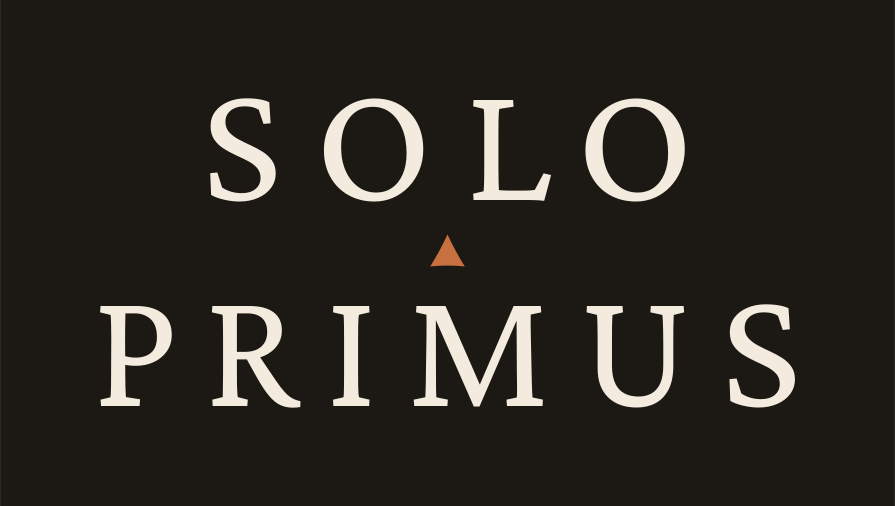
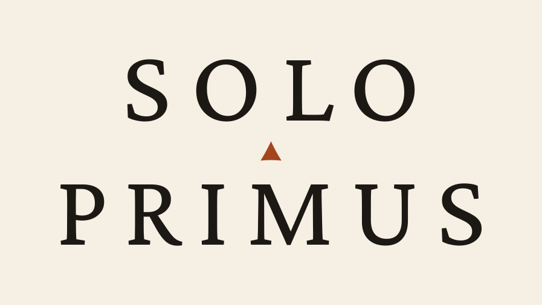
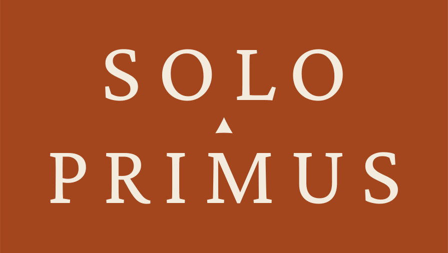

# SOLO PRIMUS logo

A stacked wordmark: SOLO over PRIMUS, with a Roman interpunct between the two lines.

 

## Files

All artwork is outlined, so no font is needed to display it.

| File | Use |
|---|---|
| `solo-primus-logo-ink.svg` | Primary logo: ivory letters and a copper interpunct on ink |
| `solo-primus-logo-paper.svg` | Ink letters on paper |
| `solo-primus-logo-copper.svg` | Ivory letters on copper, for social and print accents |
| `solo-primus-wordmark-ink.svg` | Transparent background, for light surfaces such as the website |
| `solo-primus-wordmark-ivory.svg` | Transparent background, for dark surfaces |
| `solo-primus-wordmark-black.svg`, `solo-primus-wordmark-white.svg` | One color, for print, embossing, and engraving |
| `solo-primus-horizontal-ink.svg`, `solo-primus-horizontal-ivory.svg` | Single line, for headers and narrow spaces |
| `solo-primus-avatar-ink.svg`, `-copper.svg`, `-paper.svg` | Square profile images |

## Construction

- Letters: Crimson Pro (SIL Open Font License), the site's reading typeface, set in capitals.
- Weight 400 on light fields and 380 on dark fields, because light letters on a dark field look heavier.
- Letterspacing 0.17 em, with area-based optical kerning: L–O, P–R, and R–I are tightened; S–O and O–L are opened slightly.
- C is the cap height. The gap from the SOLO baseline to the PRIMUS cap line is 1.06 C. The interpunct is 0.32 C tall and sits on the vertical axis. Keep clear space of 1 C on every side.
- The logo tiles already include that clear space.

## Colors

| Name | Hex | Role |
|---|---|---|
| Ink | `#1C1814` | Primary field |
| Ivory | `#F3EBDD` | Letters on ink and copper |
| Paper | `#F5EFE4` | Light field |
| Copper | `#A4461D` | Interpunct on light fields; copper field; the site's accent |
| Copper, light | `#C8703F` | Interpunct on ink |

## Why it looks this way

- SOLO is narrower than PRIMUS, so the centered stack rises to a point like a summit, echoing the mountain mark and the Chinese pen name 凌霄.
- Primus is Latin for “first.” Roman inscriptions separate words with small triangular interpuncts; pointed upward, this one also reads as a peak.

## Usage

- Use the files as they are. Don't retype the logo in a font, stretch it, add effects, or use colors outside this palette.
- Keep the stacked logo at least 96 px (25 mm) wide. At smaller sizes use the single-line lockup or the mountain mark.
